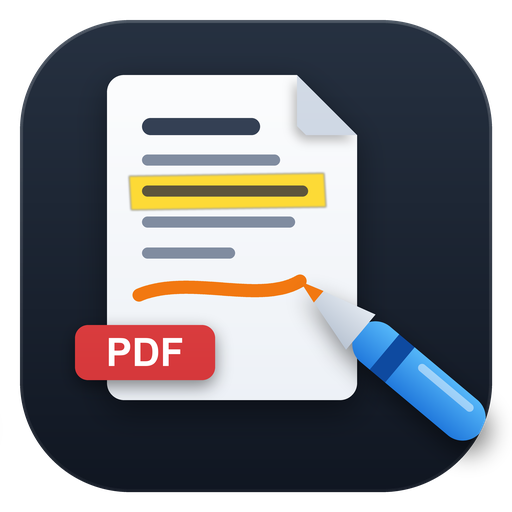
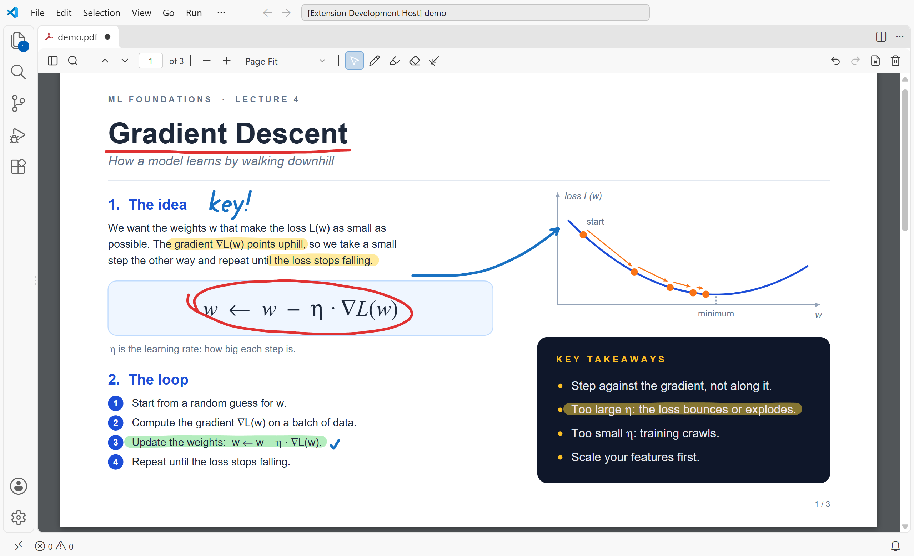
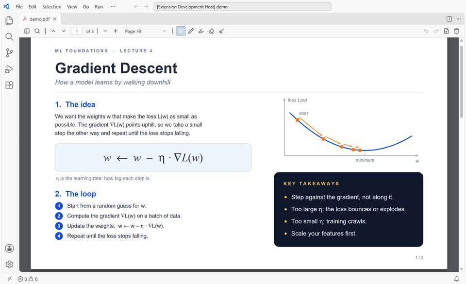
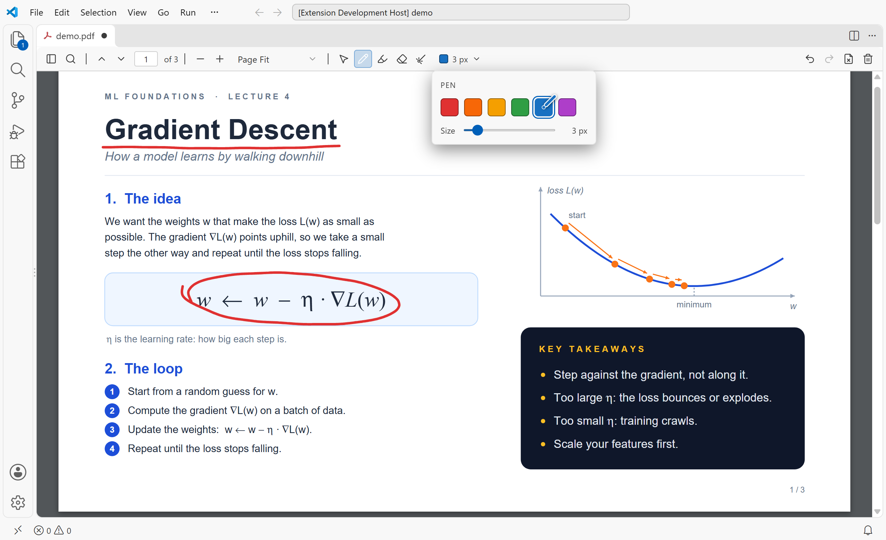
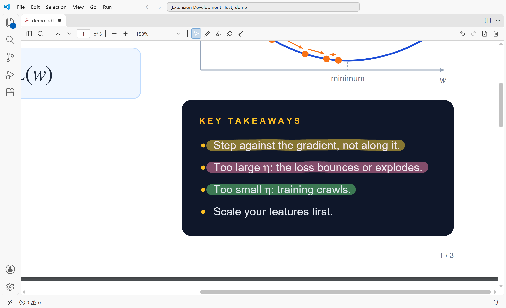
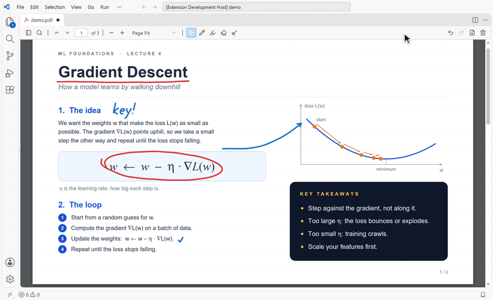
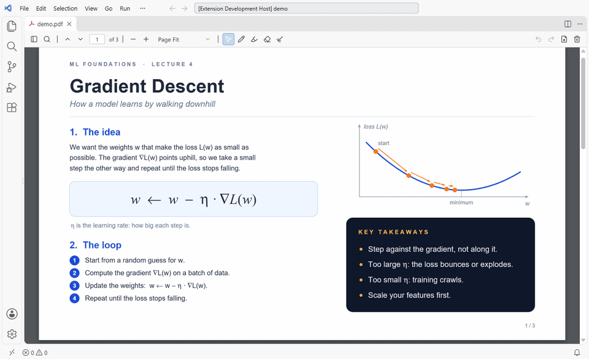
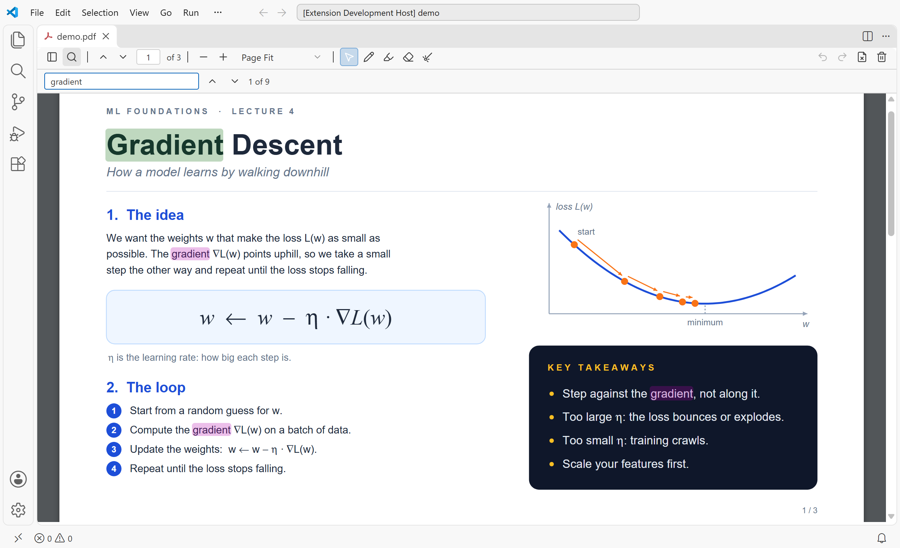
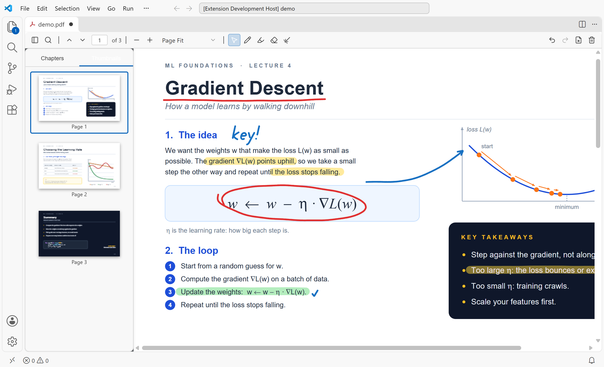

<p align="center">
  
</p>

<h1 align="center">PDF Pen Annotator</h1>

<p align="center">
  <b>Draw, highlight and point on PDFs with a pen, stylus or mouse, right inside VS Code.</b><br>
  Made for teaching, reviewing and taking notes: open a PDF, pick a tool, write on it, and save the ink into the PDF.
</p>

<p align="center">
  <a href="LICENSE"></a>
  
  
  
</p>

<p align="center">
  <a href="#install">Install</a> ·
  <a href="#quick-start">Quick start</a> ·
  <a href="#tools">Tools</a> ·
  <a href="#keyboard-shortcuts">Shortcuts</a> ·
  <a href="#faq">FAQ</a> ·
  <a href="#development">Development</a>
</p>

<p align="center">
  
</p>

---

## Why PDF Pen Annotator

- **Write the way you write on paper.** Smooth pen strokes with a graphics tablet, a touch-screen stylus or a mouse. Switch between stylus and mouse at any time.
- **A highlighter that keeps text readable.** Highlights blend with the page, so the words under them stay sharp, even on dark slides.
- **A laser pointer for teaching.** Glowing strokes that fade a few seconds after you stop, and never touch the file.
- **Real PDF annotations.** **Ctrl+S** saves your ink into the PDF itself, so it shows up in any PDF reader.
- **Nothing to set up.** Open any `.pdf` in VS Code and the toolbar is there. No account, no cloud, works offline.

## Install

The extension isn't on the Marketplace yet. Install it from a `.vsix` file:

1. Get `pdf-pen-annotator-<version>.vsix` (or build it, see [Development](#development)).
2. In VS Code open **Extensions → ··· → Install from VSIX…** and pick the file.

Or from a terminal: `code --install-extension pdf-pen-annotator-0.0.3.vsix`.

## Quick start

1. Open any `.pdf` file in VS Code. It opens in PDF Pen Annotator.
2. Pick the **Pen** in the toolbar and write on the page.
3. Press **Ctrl+S** to save the ink into the PDF.

To open a PDF in another viewer instead, right-click it and choose **Open With…**.

## Tools

| | |
| --- | --- |
| **Pen** | Freehand ink in 6 colours, with a size slider (1 to 20). |
| **Highlighter** | Translucent marker in 5 colours, size 6 to 40. Blends with the page so text stays readable, on light and dark backgrounds. |
| **Eraser** | **Stroke** mode removes a whole stroke you touch. **Partial** mode wipes only what is under the eraser circle. Size 6 to 80. |
| **Laser pointer** | Red glowing strokes for presenting. They fade after you stop drawing (1 to 15 seconds, set in its popover). Never saved. |
| **Select / Pan** | Move around the page without drawing. |
| **Undo / Redo** | Undo and redo every stroke and every erase. One eraser swipe is one undo step. |
| **Clear** | Remove all annotations on this page, or in the whole file. |
| **Find** | Search the text of the PDF, with next and previous match. |
| **Sidebar** | Page thumbnails for quick jumps. |
| **Zoom** | Zoom in and out, page width, page fit, actual size, or 50% to 400%. |

<p align="center">
  
</p>

### Highlighter

<p align="center">
  
</p>

The highlighter checks the page under each highlight. On a light page it darkens, on a dark slide it lightens, so the text under it never disappears.

<table>
  <tr>
    <td></td>
    <td></td>
  </tr>
</table>

### Eraser

<p align="center">
  
</p>

### Laser pointer

<p align="center">
  
</p>

### Find and thumbnails

<table>
  <tr>
    <td></td>
    <td></td>
  </tr>
</table>

## Keyboard shortcuts

| Keys | Action |
| --- | --- |
| **Ctrl+S** | Save the annotations into the PDF |
| **Ctrl+Z** | Undo |
| **Ctrl+Y** or **Ctrl+Shift+Z** | Redo |
| **Ctrl+F** | Find in the document |
| **Enter** / **Shift+Enter** in Find | Next / previous match |
| **Esc** | Close a popover or the find bar |

On a Mac, use **Cmd** in place of **Ctrl**.

## FAQ

**Can I use a pen tablet or a touch screen?**
Yes. Pen, touch-screen stylus and mouse all draw. You can switch between the stylus and the mouse in the middle of your work.

**Where are my annotations stored?**
In the PDF itself, as standard ink annotations, once you save. Other PDF readers (Acrobat, browsers, Preview) show them too. Until you save, VS Code keeps a backup, like any unsaved file.

**Is the laser pointer saved?**
No. It's only for pointing while you present, so it never changes the file.

**Does it send my files anywhere?**
No. Everything runs inside VS Code on your computer.

## Development

The extension is plain JavaScript with no build step. PDF.js 6.2.108 is bundled in `media/`.

```bash
git clone https://github.com/laxmimerit/pdf-pen-annotator.git
cd pdf-pen-annotator
code .
```

- Press **F5** to start an Extension Development Host, then open a PDF there.
- `node dev/server.js` serves a browser test harness at http://localhost:8765 that loads `dev/test.pdf` without VS Code.
- `npx @vscode/vsce package` builds the `.vsix`.
- `python dev/test-eraser-undo.py` checks that Undo and Redo fully reverse the eraser (uses the harness).
- `python dev/make-icon.py` redraws the logo. `python dev/record-readme.py all` re-records the README screenshots and GIFs.

`media/pdf.mjs` carries one small change to PDF.js so a stylus and a mouse can be used one after the other. It is marked `PATCHED (pdf-pen-annotator)`; apply it again if you upgrade PDF.js.

## License

[Apache License 2.0](LICENSE) © 2026 KGP Talkie

You can use, change and share this code, also in commercial work. If you publish it, or a work based on it, keep the [NOTICE](NOTICE) file with it and credit **PDF Pen Annotator by KGP Talkie** with a link to this repository.

Third-party software included in the extension (PDF.js, Adobe CMaps, Foxit and Liberation fonts) is listed in [THIRD-PARTY-NOTICES.txt](THIRD-PARTY-NOTICES.txt).

### Trademarks

The license covers the code, not the names. "PDF Pen Annotator", "KGP Talkie" and the PDF Pen Annotator logo are not licensed for use by forks. If you publish a fork, give it your own name and logo.

<p align="center">
  Made by <a href="https://www.youtube.com/kgptalkie">KGP Talkie</a> · If it helps you, please ⭐ the repo.
</p>
